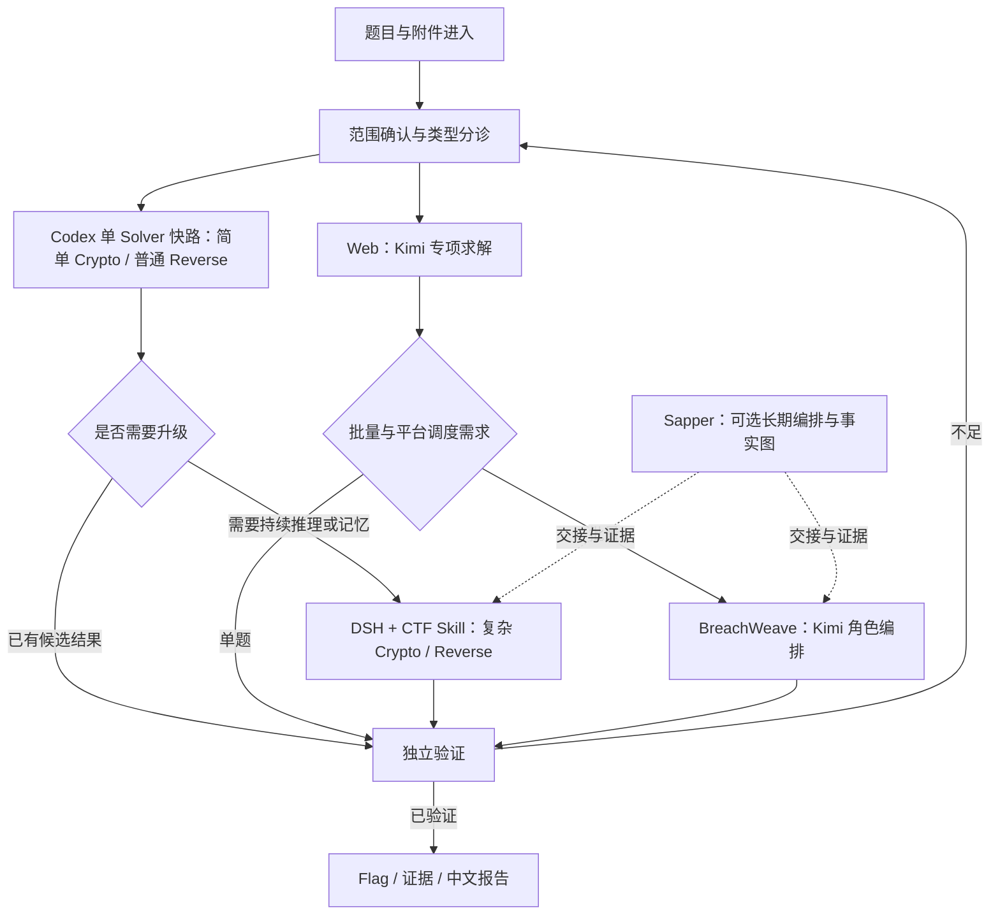

# CTF AI 工作台：推荐组合架构

状态：架构设计与配置模板，未启用跨框架自动调度。适用于授权的比赛、靶场和离线题目。本文件按用户方案整理，明确区分目标配置、现有能力与待验证假设。

## 1. 题型范围

| 一级分类 | 本次范围 | 边界 |
| --- | --- | --- |
| Web | 文件泄露、目录穿越、XSS、文件包含/上传、身份认证、业务逻辑；黑产链路追踪与对抗 | 黑产题作为 Web 子类，限题目授权范围；SQL 注入不在本次范围 |
| Reverse | 反汇编、反编译、动静态调试、注册码/Flag 校验、简单混淆、自定义算法还原 | 先静态分析，根据证据决定是否隔离执行 |
| Crypto | 古典密码、编码、RSA 等现代密码、参数变换、大整数分解、随机数、算法误用 | 候选结果须重算关系、重新加密或通过题目判题验证 |

现有 vendor 技能包含更广题型和 SQL 注入参考；保留这些上游资料不意味着纳入本次任务。新增任务必须按上表分诊。旧 README 学习笔记移至 [历史资料](legacy-notes.md)，其中未必符合当前比赛范围。

## 2. 环境与模型原则

- **目标服务器：16 核 CPU、32GB 内存、无 GPU。** 32GB 的实际字节上限应在部署时核验，不默认等同 32 GiB。
- **当前云实例：4 核 CPU 配额、32 GiB 内存上限。** 当前机器不是目标 16 核服务器；详情见 [环境记录](environment.md)。
- 模型通过云端 API 调用，不在本机部署大模型。服务器承担 Agent、Docker、浏览器、逆向/密码学工具和证据保存。
- Solver 与 Planner 优先选用当时实际可用、已验证的强推理模型；Observer/摘要按成本选择快速模型。
- 会员订阅与 API 计费不能混用作额度假设。独立框架按各自支持的 API Key/网关方式接入；凭据只通过安全环境配置提供。
- 当前 4 核机器先采用单题快路，确需并发时以 1–2 个 Solver 为起点进行资源观测；16 核目标机的并发度须基于 CPU、内存、浏览器和限流压测决定。

## 3. 四类工具的定位

下表是选型方案，不是同条件性能基准。当前已确认 DSH 上游为 deepseek-ai/deepseek-harness，BreachWeave 采用 m-sec-org/BreachWeave 的 pentest 分支。安装与运行验证范围见 [五阶段落地](staged-rollout.md)；尚未完成真实模型任务与跨框架调度。

| 工具 | 方案中的核心定位 | 最适用场景 | 主要限制与验证项 |
| --- | --- | --- | --- |
| Codex | 通用 Coding Agent；默认单 Solver 快路与分诊 | 简单 Crypto、脚本解密、普通 Reverse、题意/响应与证据分析 | 比赛专用状态、实例生命周期、队列需要项目层补齐；不假定不存在并行能力 |
| DSH + CTF Skill | 可接模型的 Harness，配合分诊、持续 Solver、结构化记忆和复核 | 复杂 Crypto/Reverse、断点续做、人工纠偏 | 并行不保证更快；模型适配、会话记忆与平台流程需按具体版本配置 |
| BreachWeave | Manager/Planner/Solver/Observer 与本地项目/资产 Web 控制台 | 自动拉题、实例管理、中小批量 Web、多 Solver 并行 | 当前采用 pentest 分支的本地资产控制台；CTF 平台接口不能按主分支假定；Crypto/Reverse 需要额外配置 |
| Sapper | 多角色编排、事实意图图、上下文交接、Watchdog | 长时间比赛、批量任务、经验继承 | 已收录源码并验证本地 CLI/任务图；完整编队需 Docker、tmux、Agent CLI、模型与平台配置，当前未启动 |

Sapper 的 commander/general/scout/soldier/watchdog 是上游完整比赛模式的角色设计，不代表当前本地查看器已经在运行这些 Agent。

## 4. 主路径

- 单题优先快路，不为简单任务强行启动完整军团。Sapper 是可选的长期编排与状态层，不应与其他框架重复指挥同一个任务。
- 每题指定唯一协调者，写明当前负责人、截止时间、预算、已尝试路径及停止条件。Observer 只观测和摘要，不直接覆盖 Solver 的结论。
- Web 专项求解与批量编排按方案使用 Kimi；Codex 可承担题意分诊、项目代码理解、响应分析和证据整理。是否执行某项操作由授权范围及各工具适用规则决定。
- 各模型均遵守适用的安全约束。安全拒绝不触发自动跨模型重试；先停止该路径并复核范围或采用允许的分析方式。限流、超时、服务故障可在同一授权任务内做有限重试/切换。
- 不以“某提供方更容易生成攻击内容”作为模型路由条件。

## 5. 模型池与角色

下列 ID/档位来自用户方案，均为候选项，未通过所选 API 网关实际验证。名字类似并不证明能力相同；`deepseek 系列` 不是可直接调用的精确模型 ID。

| 候选模型 | 候选 ID | 方案中的分工 | 请求的推理档位 |
| --- | --- | --- | --- |
| Kimi K3.1 Pro Highspeed | `kimi-k3.1-pro-highspeed` | Web 主力；DSH 默认主 Solver；BreachWeave Planner/Solver/Observer | 交互与冲刺 `high` |
| Kimi K3.1 Pro | `kimi-k3.1-pro` | 后台批量、Kimi Observer；难题深度备用 | 批量 `low`；难题候选 `max` |
| GPT-6.1 Sol | `gpt-6.1-sol` | Crypto 快路、Reverse 分析；Sapper Commander；日志与证据整理 | `medium` / `high` |
| DeepSeek V4.1 Flash | `deepseek-v4.1-flash-1017`（用户提供，API 待验证） | 可用性备用；Sapper Soldier/Scout | 待提供方确认 |
| GPT-6 Luna | `gpt-6-luna` | Observer、状态压缩、低成本摘要 | `low` |
| GPT-6 Astra | `gpt-6-astra` | 压轴 Crypto/Reverse，非 Web 路线 | `high` / `max` |
| GPT-5.5 | `gpt-5.5` | 可选 API 备用，不作为默认主力 | 提供方默认 |

### 5.1 框架内的具体约定

- Codex 快路：Crypto/Reverse 优先 Sol；仅在有明确困难证据和预算时评估 Astra。
- DSH：默认 Solver 候选为 Kimi Highspeed；复杂 Crypto/Reverse 可比较 Sol/Astra 专项配置。做框架对比时必须先锁定同一个可用模型，不能把模型变更当作框架收益。
- BreachWeave：按用户偏好将所有角色规划到 Kimi 系列；交互/Planner/Solver 优先 Highspeed，Observer 或后台批量可用标准版。此约定不等于已实现的 API 适配。
- Sapper：Commander 优先 Sol；Web 专项任务给 Kimi；Soldier/Scout 可选 DeepSeek，摘要可选 Luna。不改变本聊天可用的代理模型或擅自启动额外 Agent。

### 5.2 参数与成本控制

1. Kimi 路线要求在适配器中显式提交推理档位；API 验证应确认具体字段位置、支持值及思考开关，不能把通用 `reasoning_effort` 无条件传给所有提供方。
2. 若请求档位不受支持，应明确报错或使用经过确认的配置，不静默回退到可能更昂贵的默认 `max`。
3. “Highspeed 能力相同、速度约 2–3 倍、价格约 2 倍”仅是用户提供的待核实描述，不作为事实或自动预算依据。按实际模型卡、账单和同题测量记录判断。
4. 未给出完整 endpoint、精确模型 ID、上下文限制、输出限制、价格和 Key 绑定前，不启用调用。配置模板不存 Key 值。
5. 超时/限流切换需有次数、总耗时和费用上限。安全拒绝、授权范围不明与内容违规不纳入技术故障回退。

## 6. 状态、证据与独立验证

- 每题证据至少关联题目 ID、授权范围、附件哈希、观察、假设、复现命令、结果、时间和验证状态。秘密值不要写入提交到 Git 的报告。
- 本地事实图保存工作中状态；跨 Thread 交接提炼到 `.codex/TASK.md`，长期规则在 `AGENTS.md`，详细报告放 `docs/` 或题目独立证据目录。
- 独立验证至少为独立的复核步骤；有条件时使用不同会话/验证者，不能把 Solver 自称成功直接标成已验证。
- Crypto 重算公开关系或重新加密；Reverse 将候选输入交给已授权的校验器；Web 保留最小复现与响应证据；平台判题按比赛规则提交并记录结果，避免无意义重复提交。
- 对候选、离线验证通过、平台接受三种状态分别记录。原始事实和机器协议保持不变，面向用户的摘要优先中文。

## 7. 公平比较

每轮记录并尽量固定：模型精确版本、推理档位、输入题目、可用工具版本、实例规格、网络条件、提示模板、并发度、预算与截止时间。

结果记录成功率、有效 Flag、首个有效解耗时、总时间、输入/输出 token、实际费用、人工介入、资源峰值、错误及复核结果。相同模型也会有随机波动，应重复测量并保留失败样本。跨模型结果单独分组，不能据此宣称某框架更快。

## 8. 本次交付与后续接入

| 内容 | 状态 |
| --- | --- |
| Sapper、CTF 技能、中文反馈、项目阅读技能 | 已整合；本地开发检查此前通过 |
| 本架构、模型路由与资源规划模板 | 已整理，见 `config/architecture-plan.json`；没有运行时加载器 |
| DSH、BreachWeave | DSH 单 Solver profile 与 BreachWeave pentest 备用控制台已启动验证；真实模型与完整调度未接入 |
| 云 API 模型、价格、推理参数和真实报告遵循率 | 待 endpoint、模型可用性与安全凭据绑定验证 |
| 16 核目标服务器部署、完整竞赛编队、真实题目基准 | 未执行 |

接入顺序：确认上游版本与网关 → 最小 API 能力/费用检查 → 单题快路 → 独立验证 → 同模型条件下比较框架 → 必要时扩展批量调度。本文不宣称已部署完整组合系统。

## 实施阶段

采用用户指定的五阶段顺序，最新状态、命令和限制统一维护在 [五阶段落地记录](staged-rollout.md)。
