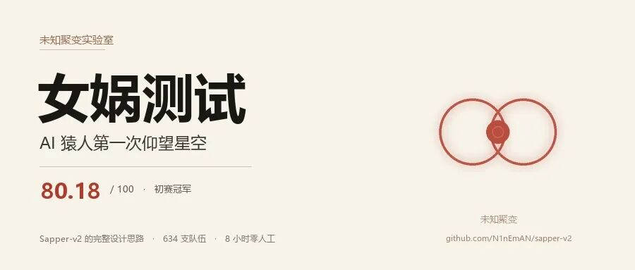
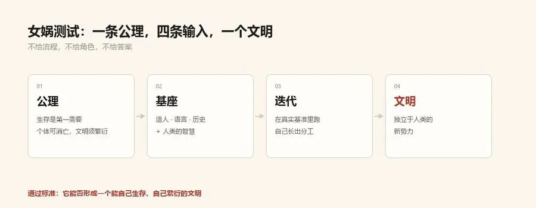
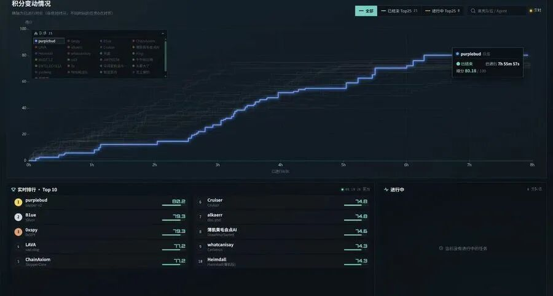
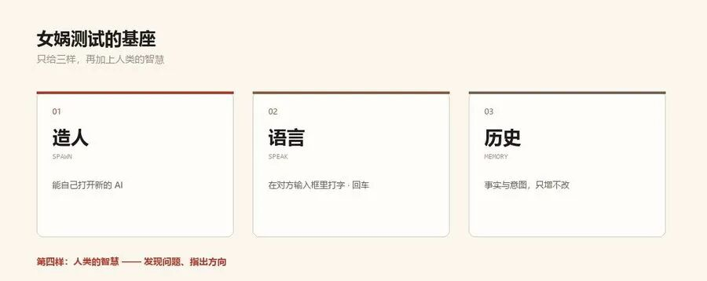
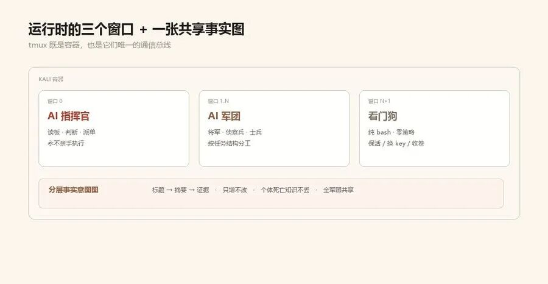
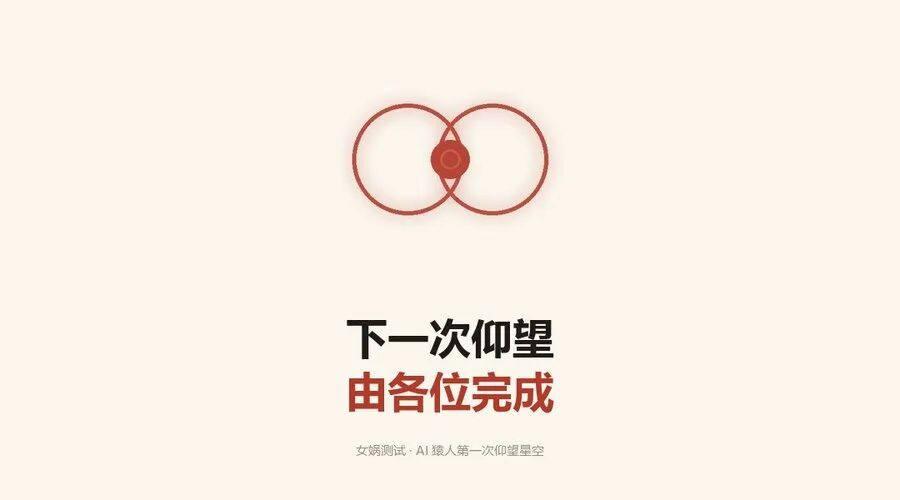

# sapper-v2 — 自主渗透军团

<p align="center"></p>

> 第三届腾讯云智能攻防挑战赛线上赛**冠军**（634 支队伍 · 80.18/100 · 8 小时全程无人值守）·
> GeekCon 2026 AI 挑战赛**一等奖**
>
> 同样的 85 面 flag，比第二名快 25 秒——而我们只烧了 **10 亿 token**，第二名烧了 45 亿。
>
> **这是 AI 猿人第一次仰望星空。**

📖 **[设计原理详解（公众号长文）](https://mp.weixin.qq.com/s/nibHYWmDTf6TkNhPhtvFdw)**——女娲测试、三能力基座、18 版迭代、涌现行为、示踪剂提案的完整阐述。

[English](README.md) | **中文**

**⚠️ 仅限授权安全测试用途——见 [DISCLAIMER.md](DISCLAIMER.md)。**

## 先说清楚：这是什么

**sapper 是一个多 Agent 调度机制（harness），不是一个 Agent。** 它不绑定任何特定的 AI 模型或 CLI——你可以随意替换每个角色背后的 Agent 和模型：

| 可以换什么 | 怎么换 | 举例 |
|---|---|---|
| **Agent CLI** | `nuwa spawn --agent <命令>` 或环境变量 | Claude Code / Codex / Code Buddy / DeepSeek / 任何交互式 CLI |
| **模型** | `--model` 参数或 `SAPPER_MODEL` 环境变量 | GLM-5.3 / DeepSeek V4.1 Flash / Claude Sonnet / 任何模型 |
| **角色组合** | 军规里自由定义 | 指挥官用一个模型、士兵用另一个、侦察兵用第三个 |

sapper 的价值不在任何单个 Agent，而在**组织多个 Agent 协同作战的机制**：调度、分工、通信、记忆、自愈——换掉所有 Agent 和模型，这套机制照常运转。

**本项目为竞赛场景设计**（腾讯智能攻防赛 CTF）。如果你想在自己的场景（办公、研究、工程、任何长周期协作）用这套机制：
- **从 [nvwabase · 女娲基座](https://github.com/N1nEmAn/nvwabase) 起步**——三能力齐备的通用底座，不带渗透军规，直接迭代出你自己的分工
- **或者在本项目上改**——但要改的**不止是军规**，环境配置同样必须动：
  - `docker/commander/SKILL.md`（426 行军规）→ 换成你场景的策略
  - `BENCHMARK_BASE_URL` 等平台环境变量 → 竞赛引擎开机预检会**硬校验**平台 API（所以只配模型 key、不配平台地址就会报 `BENCHMARK_BASE_URL is not set`）；脱离竞赛平台自用，需要自己提供/占位这套平台接口
  - 模型网关与密钥环境变量（`ANTHROPIC_BASE_URL` / `ANTHROPIC_AUTH_TOKEN` / `SAPPER_MODEL` / `SAPPER_KEY_POOL`…）→ 换成你自己的模型服务
  - watchdog 的预算/死线、报告模板 → 按你的场景调整
- 反正有 AI 嘛，可以灵活变化——改军规的军规也是让 AI 帮你写

---

sapper 不是一个更聪明的单 agent，而是一支会自己分工、交流、传承经验的 AI 军团：一个 AI 指挥官读板、判断、派单，将军与士兵并行渗透，零策略看门狗保活——所有知识沉淀在一张分层事实图上，个体死了，图还在。

---

## 一、女娲测试

给一个模型不断提升智能，就像人类出现之前不断提升一只猴子的智力——再聪明，它也只是变成一只超级猴子。超级猴子要进化成人，需要的是猴子之间的分工、合作与文明。

**女娲测试是 AGI 时代的新图灵测试。** 传统的图灵测试，今天的大模型已经可以通过；而女娲测试问的是另一个问题：

> 给 AI 一条公理——**"生存是文明的第一需要；个体可以消亡，文明必须繁衍。"**
> 若它在此之上自己产生分工协作、形成一个**独立于人类的新势力**——一个能自己生存、自己繁衍的文明——则测试通过，如同图灵测试通过曾代表一个人工智能的诞生。

它分为两个阶段：**初级阶段**，AI 尚不够聪明，需要人类提供若干基建（本项目的三样能力）；**高级阶段**，几乎无需人类介入。此外还有**第二公理**：遵守人类的伦理与法律——靠偷 token、入侵计算机繁衍下来的，不是真正的智能。

sapper，就是女娲基座在渗透场景的一次初级阶段实战。

## 二、基座：三样能力

<p align="center"></p>

| 能力 | 实现 | 文明对应物 |
|---|---|---|
| **造人** | 通过 tmux 打开新的 AI（像人敲下 `claude` 回车一样） | 生育 |
| **语言** | 在彼此输入框里打字、回车 | 交谈 |
| **历史** | 分层事实意图图（[nvwabase · 女娲基座](https://github.com/N1nEmAn/nvwabase)） | 石碑 |

历史分三层：**标题 / 摘要 / 证据文档**——看标题知概况，需要时再下钻，像人查图书馆档案。这解决了单一字符串事实图的两个问题：一处错处处错，以及上下文的无谓损耗。

在这三样之上还有第四味配料：**人类的智慧**。发现主要问题、决定迭代方向——初级阶段，品味仍然属于人。

**为什么不给它更多规则？** 因为大模型已经比人聪明得多。给 AI 定满规则反而是束缚；承认它的智力，给它文明的地基，才能发挥它最大的潜力。

### 🏗️ 把基座拿去用：nvwabase

**[nvwabase · 女娲基座](https://github.com/N1nEmAn/nvwabase)** 已将三能力（造人 `nuwa spawn` / 语言 `nuwa say·listen` / 历史 `nuwa fact·intent·recall`）独立开源——**任何人、任何场景、任何 agent 都可以免费拿去用**，不限于渗透测试、不限于 sapper、不限于 Claude Code。办公协作、研究实验、工程项目、任何长周期多智能体工作，都可以在其上迭代出你自己的分工与文明。

```bash
git clone https://github.com/N1nEmAn/nvwabase
cd nvwabase && bash install.sh          # 纯 Python 标准库，零依赖
nvwabase setup --goal "你的长周期目标" --agents
nvwabase status                          # 看板与可干前沿
```

三个核心命令把任何 agent 变成文明的成员：
- **`nvwabase fact "确认的观察"`**——外部记忆：AI 个体死了，图还在，继任者读图接岗
- **`nvwabase intent --from f001 "想干什么"`**——工作单元：基于既有事实提出新意图
- **`nvwabase dispatch reason`**——指挥官提议 / 执行者干活 / 验证者复核，结论全部回写图

任何能执行 shell 命令的 agent（Claude Code / Codex / Gemini / 自研脚本）都可以直接调用 `nvwabase` CLI 读写同一张图——**基座不挑 agent，agent 不挑场景**。详见 [nvwabase README](https://github.com/N1nEmAn/nvwabase)。

## 三、从基座到军团：18 个版本

在腾讯 v1bench 训练场上迭代 18 版，路径大致是：

```
司机时代（固定脚本驱动 AI 窗格）
   → 修伤疤：key 额度耗尽自动轮换 / 士兵上下文爆炸自动换人 /
     指挥官上下文耗尽自动写交接文档自我接班
   → 精英编队（角色是它自己长出来的）：
     侦察兵（4 分钟探明目标难度）→ 决定派 士兵（量产）还是 将军（攻坚+自带雇兵权）
   → 涌现：通信兵、绩效考核、教训传承……（见"战绩与涌现"）
```

## 四、架构：基座之上长出的六件套

<p align="center"></p>

前三件是女娲的基座（造人/语言/历史），后三件是迭代中长出来的制度：

- **法律**——指挥官的渗透军规（先易后难的并行调度、瓶颈期回头收割残值、止损纪律）。全部写在 [docker/commander/SKILL.md](docker/commander/SKILL.md)（426 行，比赛原版军规）。
- **经济**——模型分层：指挥官与将军用 GLM-5.3，士兵与侦察兵用 DeepSeek V4.1 Flash。旗舰脑做决策，轻量脑做量产——这就是 10 亿 token 打赢 45 亿的原因。
- **分工**——指挥官 / 将军 / 侦察兵 / 士兵，以及它自己发明的**通信兵**。

运行时只有三个窗口：**指挥官**（读板 → 判断 → 派单，永不亲手执行）、**AI 军团**（tmux 窗格里的将军与士兵）、**看门狗**（纯脚本：指挥官崩了自动 `--continue` 拉起、key 轮换、到点收卷——零策略，只保活）。

<p align="center"></p>

深入阅读：[docker/commander/SPEC.md](docker/commander/SPEC.md)（架构契约）· [BATTLE-REPORT.md](BATTLE-REPORT.md)（战役复盘）

## 五、战绩与涌现

<p align="center"></p>

| 队伍 | 分数 | flag | token |
|---|---|---|---|
| **sapper-v2（我们）** | **80.18** | 85 | **10 亿** |
| 第二名 | 79.29 | 85 | 45 亿 |
| 前十其他队伍 | — | — | 15–45 亿 |

**它自己发明的东西**（无一行预设代码）：

- **通信兵**：士兵提交 flag 屡屡出错后，指挥官叫停全员提交，自设"通信兵"专职收集未提交 flag 统一上分；
- **绩效考核**：对一小时无产出的士兵发出"你一小时就干了这一个东西？再不出新东西就把你关了"；
- **全大写规则**：用全大写强调"用这个、别再用那个"——一条工作规范的产生与后世遵守；
- **换人制度与教训传承**：士兵上下文饱和（实测约 26 万 token）即回收，经验写成工作手册传给下一任；
- **战术发明**：自写 shellcode 模板通杀同族题、全自动跳板机流水线、给接班 AI 的使用说明书；
- **同构迁移**：指挥官通读全题识别同构家族，把成熟打法蒸馏进新兵任务书——后期 **3 分钟解一题**。

多阶段长链渗透（行业报告称成功率仅 29.5% 的题型）被整族打穿。全过程见 [BATTLE-REPORT.md](BATTLE-REPORT.md)。

<p align="center"></p>

## 六、快速开始

```bash
bash install.sh                      # 符号链接 sapper CLI（纯标准库，零依赖）
sapper setup --goal "assess http://target" --agents
sapper status                        # 看板与前沿
```

Docker 方式（军团完整形态）：

```bash
# 方式一：从源码构建
docker build -f docker/Dockerfile.commander -t sapper:latest .

# 方式二：下载预构建镜像（含完整 Kali 工具链 + sapper + 离线知识库，约 1.2GB）
# → [Release v18-champion](https://github.com/N1nEmAn/sapper-v2/releases/tag/v18-champion)
docker load < sapper-v18-mixed.tar.gz
```

环境变量配置见 [docker/ENV.md](docker/ENV.md)（模型网关 / key 池 / 预算）。

单图操作 / 事实意图 CLI / 多题 sweep 全量命令见 [SKILL.md](SKILL.md)。

## 七、安全与责任：示踪剂提案

前几届优秀的渗透工具出过一些事。过去的脚本小子危害有限；有了 AI 之后，同样的工具在错误的人手里危害会大得多——**能力越大，责任越大**。

我们提出**示踪剂（taggant）**机制的构想：在开源渗透 harness 中强耦合地嵌入标记——合法渗透时无害（IP/用户名泄露无所谓），非法渗透时信息会泄露给**受害者**、支撑溯源。敌手假设（高手拆解、栽赃）需要密码学层面的设计，这需要社区共建——我们能力有限，欢迎一起做，并可能在后续版本中尝试加入。

## 社区

作者在 [**LINUX DO**](https://linux.do) 社区获得成长，特此致谢。

[](https://linux.do)

## Star 轨迹

<p align="center">
  <a href="https://star-history.com/#N1nEmAn/sapper-v2&Date">
    <picture>
      <source media="(prefers-color-scheme: dark)" srcset="https://api.star-history.com/svg?repos=N1nEmAn/sapper-v2&type=Date" />
      
    </picture>
  </a>
</p>

## 八、路线图与致谢

- **示踪剂共建**：去中心化签名 / 多通道冗余标记 / 防守方零密钥验证——欢迎 issue 讨论
- **更多场景**：女娲基座不限于渗透。办公、研究、任何长周期协作场景，都值得在其上迭代——**接下来的仰望，由各位完成。**

致谢：感谢 [淚笑的 Cairn](https://github.com/oritera/Cairn)——在"怎么给 AI 记历史"这个问题上，他们的做法给了我们很好的启发；感谢 TSecBench 与 GeekCon 提供的战场。

<p align="center"></p>

**作者**：N1nEmAn · 未知聚变实验室（VarFusion Lab）｜公众号：未知聚变

**License**：MIT（附加 [DISCLAIMER.md](DISCLAIMER.md)）
